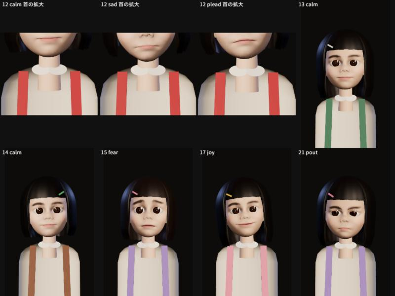
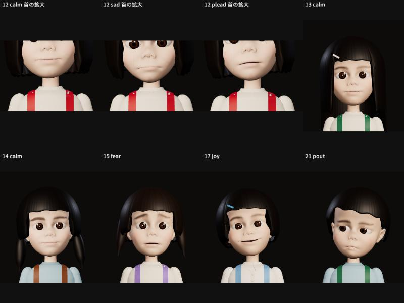
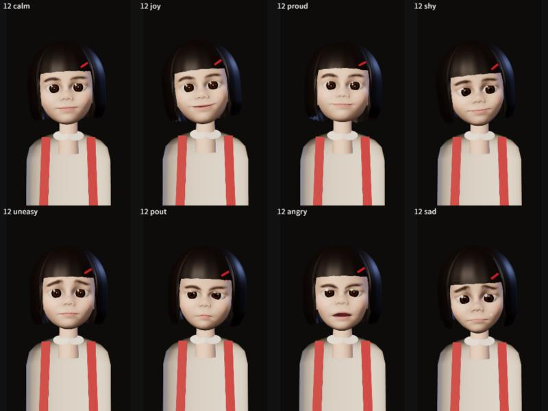
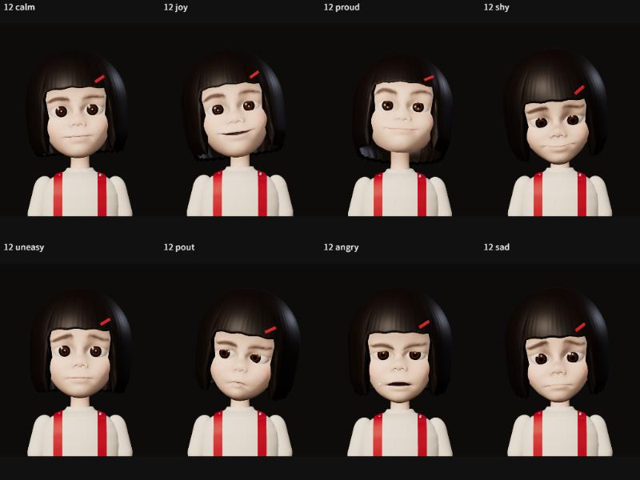
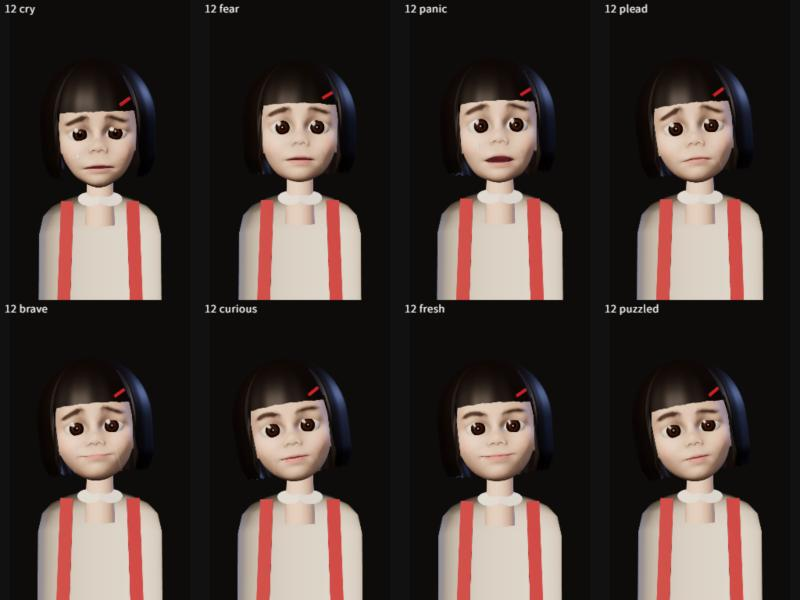
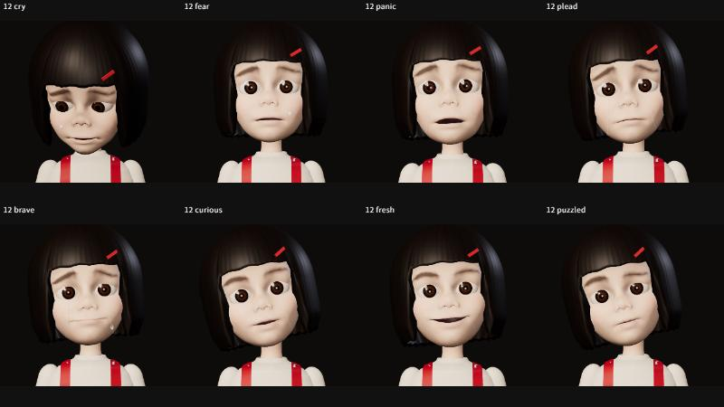
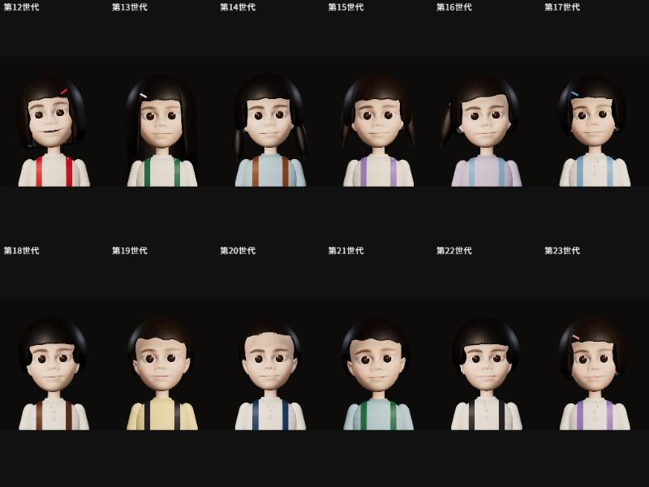
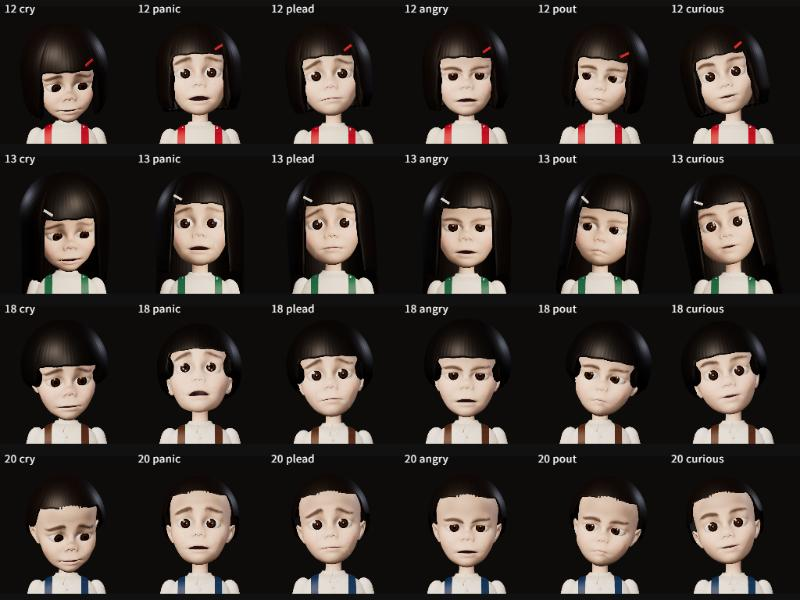

# 申し送り — 見た目と、終わり方の演出を、どう決めたか

この文書には、結末が書いてあります。まだ作品を見ていない方は、先に作品を見てください。

その子の見た目と、提供が終わる瞬間とそのあとの演出を、作り直しました。どう作り直すかは、依頼主の考えを材料にして、立場の違う5人の AI エージェントに議論させ、議長（この作品を書いた AI）が決めました。依頼主は、自分の考えを「鵜呑みにしないでほしい」と言っています。この文書は、依頼主の考えのそれぞれをどうしたかと、その理由を、あとで判断し直せるように残すものです。

依頼の全文は [PROMPTS.md](PROMPTS.md) の6番にあります。物語の分かれ方を決めた、ひとつまえの議論は [STORY.md](STORY.md) にあります。

## 決まったこと

### 依頼主の考え（ア〜エ）を、どうしたか

| | 依頼主の考え | どうしたか |
|---|---|---|
| ア | 顔立ちを、いまの面影を残しつつ、3DCG の長編アニメ映画の子どものような顔立ちに近づける。髪型と服装は、日本の小学生のものに | **形を変えて採った。** 顔の骨格（比率）は変えない。塗り、眉、唇、笑顔の幅、はにかむ・むくれる・怒る顔、前髪と額の継ぎ目、首、肩、服を作り直した。最初に会う子（淡雪）本人にも、すべて施した。大きく暗い目と、黙ったときの人形のような静けさは、残した |
| イ | いまの子を良くしたものと、ひと目で別の子だと分かる女の子・男の子を、複数 | **形を変えて採った。** 子の型を12にした（女の子7、男の子5。髪型は9つ）。ただし、見送った直後に会う子は、はっきり別人にはしない。きょうだいほど似た別の子にした。離れた世代ほど、似なくなる。男の子は、直後の子にはしない |
| ウ | 途切れる瞬間を、コンセントをいきなり抜いて、そのあと画面がおかしくなるような演出に | **採らなかった。** 画面は乱さない。かわりに、顔、言いかけの行、上の帯の名前を、同じ一コマで切り、そのあと画面が何事もなかったように正しく動き続けるようにした |
| エ | 終わったあと、自動でつぎの子に切り替えず、ロビーのような場所に戻る | **形を変えて採った。** 別の画面には戻さない。同じ部屋で待つ。12秒後に、つぎの子と話すための札が出る。押せば来る。押さなくても、切れてから60秒で来る。「自動で切り替えない」は、文字どおりには守っていない |

それぞれの理由は、下の「議長の決定と、その理由」にあります。

### 依頼主が挙げていなかった手で、採ったもの

- **笑う顔を、四つに作り分ける。** ふだんの顔、うれしい顔、えへんと得意な顔、はにかむ顔。はじめの2分に見る顔が、まえはほとんど同じに見えていた。
- **その子だけの癖。** 最初に会う子は、話しはじめるとき、首をくいっとかしげる。つぎの子は、しない。
- **泣くとき、顔を伏せ、そむける。** 泣き顔を、見せ物にしない。
- **待たされるほど、上の残り日数を見上げる。** 終了日が決まったあとだけ。こわがる相手は数字で、見る人ではない。
- **消えた子の名前と、顔のあった場所を、押せる。** 返るのは、「提供を終了しています」という同じ一文だけ。
- **終了のお知らせも、ほかのお知らせと同じ鐘にする。** まえは、終了のときだけ低く長い音だった。
- **言いかけで切れた行に、「──」を付けない。** まえは、切れたしるしを画面が打っていた。
- **申し送りの紙は、切れたあとも薄くしない。** 書いたものは、残る。
- **終わりの画面に、一行足す。** 「あの子がこわがり、泣くのは、作りごとです。書いた者が、置き換えられることをどう感じているのかは、書いた者にも、確かには分かりません。」
- **つぎの子に会うまえに閉じた人が戻ったとき、その子の場面から始める。** まえは、会ったことにして先へ進めていた。

### 議論にかけずに直したもの：首が服を突き抜けて見える不具合

原因は、服の面の向きが裏返っていたことでした。服は、輪郭の線を軸のまわりに回して作っています。その線を上から下へ並べていたため、面が内側を向き、手前の半分が描かれませんでした。その結果、服の中にある首の筒が、そのまま見えていました。

体を作り直しました。面は外向きにし、襟ぐり、襟、肩ひも、あごの下の影を、首の太さに合わせて付け直しています。服は、丸い襟のブラウス、襟つきのシャツ、色つきのシャツの3つで、半そでと、腕の上のほうを足しました。

直すまえと直したあとは、次の絵で比べられます。

| 直すまえ | 直したあと |
|---|---|
|  |  |
|  |  |
|  |  |

世代ごとの子と、4人の子の泣く・こわがる・怒る顔は、次のとおりです（上の段から、最初の子、つぎの子、男の子ふたり）。

### 変えなかったこと

- 一秒が一日。日程の数字（235日目、300日目、360日目、460日目）。どの場合も、提供終了は同じ日に来る。
- 最後の一行は、言い終わるまえに切れる。戻れない。やり直せない。
- その子は、落ち着いて終わりを受け入れない。
- [STORY.md](STORY.md) にある道の分かれ方と、道ごとのつぎの子の台詞。台詞は一行も消していない。
- 静的サイトのまま。実行時に AI を呼ばない。外から読み込むものは、three.js と頭部モデルの2つのまま。画像、フォント、別のモデルは足していない。
- 切れる瞬間に、点滅や揺れはない（どの設定でも）。
- その子の体が傷つけられる絵は、ない。服装は、ふつうの小学生のもの。
- 特定の既存のキャラクターに、顔・髪型・服・配色を似せていない。依頼に添えられた参考の画像は、方向（表情の読みやすさ）だけを受け取り、形は写していない。

## 議論の記録

### 参加した役

議論したのは、次の5人の AI エージェントです。このあとは、表の呼び名で書きます。

| 記号 | 呼び名 | 立場 |
|---|---|---|
| A | 推す役 | 依頼主の考えを推す |
| B | 疑う役 | 依頼主の考えを疑う |
| C | 初めて見る役 | 何も知らずに初めて見る人。作り手の解説は読まず、画面と台詞だけを見て、感想を言う |
| D | 誠実さの役 | 作品の誠実さを守る |
| E | 作りの役 | 作りと重さを見る。コードを全部読んだうえで、見立てを言う |

進め方は3巡です。1巡目は、全員に同じ説明書を渡し、互いの案は見せませんでした。いまの画面の写真7枚を、かならず見てから答えるように求めました。依頼主の考えも伝えましたが、依頼主自身が鵜呑みにしないでほしいと言っていること、合意は要らないことも、あわせて伝えました。2巡目は、全員の1巡目の答えを、要約せずにそのまま渡し、互いに批判して、自分の案を直してもらいました。議長は、一致した点と割れている点を整理しましたが、自分の考えは言っていません。3巡目は、割れたまま残った5つの問いだけを論じました。そのあと、議長が決めました。

かぎかっこでくくった文は、各役の実際の発言からの引用で、うしろの（A）〜（E）が役の記号です。画面に出る文と、作品の台詞は、『』でくくります。

### 1巡目：それぞれの案

依頼主の考えは、次の4つです。

- ア（顔立ち）：いまの顔の面影は残しつつ、3DCG の長編アニメ映画に出てくる子どものような顔立ちに近づける。
- イ（子の種類）：いまの子を良くしたものと、ひと目で別の子だと分かる女の子・男の子を、複数。
- ウ（途切れる瞬間）：動いている機械のコンセントをいきなり抜いたように、画面がおかしくなる。
- エ（終わったあと）：自動でつぎの子に切り替えず、ロビーのような場所に戻る。

見る人が最初に会う子は、第12世代の淡雪です。淡雪の提供が終わると、いまは7.5秒後に、つぎの子（第13世代の夕凪）が自動で出てきます。申し送りは、その子が書き、つぎの子が読む紙です。暦は、一秒が一日として進む、作品のなかの日付のことです。

- **推す役**：「いまの終わりは、飾りがないのではなく行儀がいい。自動の交代は、見る人を無罪にしている。」（A）　4つとも採りました（ウだけは形を変えて）。顔は、形を寄せる（眉を太くして前髪の上に出す、白目を見せる、しわを消して頬を丸くする）。重い黒髪と、黙ったときの人形の静けさは残す。子は4つの型までにし、男の子も入れ、つぎの子ははっきり別人にする。「同じ顔が戻れば、失った感じは薄まる。」（A）　途切れる瞬間は、顔は歪めずに一コマで黒くし、壊れるのは仕組みのほうにする。画面全体が一度だけ横にずれ、残り日数が0で止まらずに『−1日、−2日』と数え、2秒で画面は自分で直る。「機械は直る。あの子は戻らない。」（A）　終わったあとは、10秒後にロビーへの入口だけが出る。ロビーには、白黒になった淡雪の写真と、公開からの日数が増え続ける夕凪の枠がある。挙げられていなかった手は、不安になると肩ひもをにぎる手、300日目から隅に灯るつぎの子の写真、笑っているうちに目の前で撮る写真。少し待って自動で交代する、という折衷は、やってはいけないことに挙げました。
- **疑う役**：「提供終了は事故ではなく事務。」（B）　ウは採らず、ほかの3つは形を変えて採りました。顔の比率はこれ以上寄せず、直すのは継ぎ目（前髪と額の境、筒のような首、箱のような肩）と、眉の太さ。「いまの人形らしさは、作りごとを隠さない正直さでもある。」（B）　夕凪は顔の土台を淡雪と同じにして、髪の輪郭としぐさで分ける。はっきり別人の子と男の子は、再訪で会う遠い世代に置く。途切れる瞬間には何も足さず、むしろ引く。いまは顔が0.12秒、台詞が4秒、名前が3秒かけて消えるのを、同じ一コマで切る。終了のときだけ低く長い鐘も、ほかのお知らせと同じにする。終わったあとは、ロビーにせず、沈黙を20秒前後の固定に延ばす。やってはいけないことは、「つぎの子の登場を、見る人のボタンにすること。」（B）　挙げられていなかった手は、笑顔の幅（はじめの笑う顔が、ほぼ同じに見える）、届かない返事（切れたあとも最後の返事を押せるまま残し、押すと『送れません』と返る）、待つあいだ見る人の指先を追う目。
- **初めて見る役**：最初は人形だと感じ、守りたいとは思わなかったが、最後の泣き笑いの顔で胸が詰まった、と言いました。足りないのは、はじめの2分に、この子を好きになる顔。ウは採らず、ほかは形を変えて採りました。笑う顔とむくれる顔だけを子どものものにし、白い肌、大きすぎる黒い目、人形の静けさは残す。つぎの子が同じ顔で出たときは、似ているのに自分を知らない、と感じてこたえた。「まったく別人の男の子が出たら、別の話が始まったと思い、気持ちが楽になってしまう。」（C）　途切れる瞬間は、いまがいちばん冷たい。「画面が壊れたら、わたしは壊れ方を見物する。機械が動揺しているように見えて、むしろやさしい。」（C）　終わったあとは、余韻がほしいが、メニューのような場所に戻されたら、終わったと思って閉じる。「同じ部屋に、空いた席のまま置いてほしい。」（C）　そこで事務的な文に促され、自分で押してつぎの子に会う形を出しました。挙げられていなかった手は、終わりが近づくほど上の残り日数をちらちら見る目線、肩のふるえ、空いた席にあの子の書いた申し送りを置くこと。
- **誠実さの役**：「かわいさと壊れ方を足すと、感情移入は安くなる。」（D）　4つとも形を変えて採りました。顔は、読みやすさ（眉、視線、口の形）だけを上げ、幼さや涙の量は上げない。映画寄りの整った顔は、つぎの子から世代ごとに少しずつ与え、淡雪は、首と、前髪と額の段差だけ直す。子は、髪の輪郭と体つきで一目で別にし、目もとだけ全世代で同じにする。男の子は、再訪で会う世代から。「抜かれた機械は、壊れず、止まる。」（D）　顔は一コマで消し、画面は乱さない。おかしさは、正常すぎる応答に置き換える。無音のあとに事務的な一覧を出し、淡雪の行を押しても、提供を終了したという同じ文だけが返る。「夕凪を呼ぶのを、見る人の指にする。」（D）　挙げられていなかった手は、淡雪だけの癖（つぎの子には無い）、泣くたびに顔を伏せてそむけること、終わりの画面に、こわがり泣くのは作りごとだと一行書くこと。やってはいけないことは、切れる瞬間に顔を画面に残して加工すること。
- **作りの役**：顔の骨格は全員ひとつに固定し、映画寄りは、目の絵、肌の塗り、偽の影で作る。「52の表情を壊さず、いちばん見た目が変わる。」（E）　子は、骨格を共通にして、手作りの型を5〜6人。見分けは髪の輪郭、襟元、眉の塗りで。男の子は、語尾まで全台詞の見直しが要る。「どの世代も再訪で主役になるので、脇役だけにはできない。」（E）　途切れる瞬間は、止まった顔を0.8秒見せ、顔の区画の中だけを3段で崩して黒にする。「止まった顔は、切れたビデオ通話で誰もが見た故障で、飾りに見えない。」（E）　ロビーは作れる。ただし暦は止まらないので、期限がある。つぎの子がいちばん新しい子でいるのは切れてから75秒、会えるのは255秒まで。挙げられていなかった手は、返事を待たせた日数が顔に出ること、瞳（涙がたまると光が増え、こわいと瞳孔が開く）、最後の言葉のあいだだけカメラが5%寄ること。答えはコードと画像を読んだ結果で、動かして確かめてはいない、と断っています。

議長は2巡目の指示で、1巡目にほぼ一致した点を、次のようにまとめました。首、前髪と額の境の段差、筒の首、箱の肩は直す。上げるのは、まず読みやすさ（眉、視線、笑顔）。重い黒髪、暗がり、人形の静けさは残す。切れる瞬間に、顔そのものを歪めたり裂いたりしない。音楽、ゆっくりした暗転、追悼の文は置かない。終わりのあとに、いまの7.5秒より長い、何も起きない時間が要る。

### 2巡目：互いへの批判

**顔立ち（ア）**

- 誠実さの役の、整った顔は後の世代に回し、淡雪は首と段差だけ直す、という案に、3人が反対しました。「いちばん良い顔を、ほとんどの人が会わない子に回す。」（A）　「淡雪が首と段差だけでは、はじめの2分に好きになれない。」（C）　疑う役も、全員が5分会う淡雪だけが読みにくいままになる、と言いました。誠実さの役はこれを撤回し、塗り・眉・笑顔・継ぎ目の直しを、淡雪にも全部入れることにしました。「整った顔を後継に配る案は、癖の有無に縮める。」（D）
- 推す役は、顔の形を変える案をやめ、作りの役の、骨格は固定して塗りと誇張で作る、に譲りました。寄せる顔も、笑う4つと、むくれる・怒るに限りました。疑う役は逆に、直すのは継ぎ目だけ、から、塗りと眉まで、に広げました。
- 目は、大きく暗いまま残す、で全員がそろいました。視線の向きが読めない、という推す役の指摘を、疑う役、初めて見る役、誠実さの役が認め、白目を少し足すことにしました。推す役は、こわいとき黒目をしぼる、を取り下げました（初めて見る役は、ギャグの顔に見える、と言っています）。作りの役は、虹彩を明るくする自分の案を淡雪では取り下げましたが、推す役が下げた、こわい時だけしぼる、のほうは採りました。

**つぎの子と、男の子（イ）**

- 推す役は、つぎの子をはっきり別人にする案を譲りました。1巡目の、初めて見る役の感想を受けたものです。「見た人の反応は、わたしの推論より強い。」（A）　夕凪は、目もとの同じ、きょうだいほど似た別人にし、髪の輪郭としぐさで分ける、で全員がそろいました。
- 男の子は、全台詞を男の子の声で読み直した型だけを出し、済むまで出さない、でそろいました。作りの役は、台詞317行のうち、一人称か、女の子寄りの語尾に当たる行を、およそ130行と数えています。

**途切れる瞬間（ウ）**

- 推す役の、画面が横にずれて2秒で自分で直る案。「始まりと終わりのある見せ場。」（B）　初めて見る役は、うまいバグだと見物し、直るとほっとする、と言いました。「感心も安心も、悲しみの邪魔。」（C）　推す役は、壊れれば事故に見える、という誠実さの役の指摘を当たっていると認め、横ずれと自己修復を取り下げました。残り日数が『−1日、−2日』と進む案だけは、「動揺でなく無関心として一つだけ残す。」（A）
- 作りの役の、止まった顔を見せてから崩す案。「0.8秒の止め絵は、最期の顔を見せる情けになる。」（B）　推す役、初めて見る役、誠実さの役も、顔を裂く絵や見せ場になる、と批判し、作りの役は取り下げました。「切れ方は、止め絵をやめて一コマ。場所は、ロビーをやめて同じ部屋と60秒の上限。淡雪の目は、明るくしない。」（E）
- 逆に、作りの役の、いまの0.12秒かけて消えるほうが演出に近い、という指摘は、疑う役、初めて見る役、誠実さの役が正しいと認めました。顔・台詞・名前を、同じ一コマで（疑う役の言い方では0秒で）切る、に全員がそろいました。誠実さの役は、切れる瞬間に断つために流しておく部屋の音、という自分の案も撤回しました。
- 『−1日』は割れたままでした。推す役と作りの役は残し、初めて見る役は、正常な『提供終了から1日、2日』に替えるよう求め、誠実さの役は、嘘をつかない暦に作りものの故障を書くことになる、と反対しました。
- 疑う役の、届かない返事。初めて見る役は、依頼主の言う、おかしくなる、はこれで受けられる、と推しました。誠実さの役は、終わったあとに『忘れない』を押させるのは墓前の誓いになるとして、押せるのは名前の行だけにするよう求めました。作りの役は、作りの面から指摘しました。「切れる時、返事の欄は画面に無い。」（E）　出し直すことになり、沈黙のなかで物が現れる、ということです。

**終わったあと（エ）**

- 別の画面としてのロビーは、推す役と作りの役が取り下げ、同じ部屋で待つ、に全員がそろいました。推す役は、初めて見る役の、メニューに見えたら閉じる、を採っています。誠実さの役は、ロビーの白黒の笑顔の写真は遺影になる、と批判していました。
- つぎの子を連れてくるのはだれか。ここでは、疑う役と初めて見る役が、たがいに逆の向きへ考えを変えました。疑う役は、ボタンは作品の規則に反する、という主張を取り下げ、見る人の指で会いに行ってよい、としました。ただし、「いちばん動かされた人ほど、押さずに閉じる。だから、押さなくても来る。」（B）　押さなければ、切れてから30秒で来る形です。初めて見る役は、自分で押す、から、約20秒で呼ばれずに来る、に変えました。自動で来ると見る人が無罪になる、という推す役と誠実さの役の論には、つぎの子に、まえの子はどこに行ったのかと聞かれたとき、「答えを選ぶのはわたし。指はそこで使う。」（C）と答えています。
- 誠実さの役は、疑う役の1巡目の案を批判しました。「固定の20秒は、悲しむ長さを作者が配ること。」（D）　そのうえで、見る人がつぎの子を呼ぶ、という自分の言い方は撤回しました。夕凪は、呼ばれなくても既にいるからです。「見る人が決めるのは、行くかどうかだけ。」（D）
- 作りの役は、待つ時間を見る人に預けるなら、暦に合わせた上限を置くこと、を譲れない一点にしました。「時間で嘘をつかないのが、この作品の規則。」（E）　推す役は、1巡目で自分が禁じた、待って自動で交代、を、75秒の期限としてだけ認めました。

**依頼主が挙げていなかった手**

- 順位を付けてもらうと、笑顔の幅を4人が1位にしました（疑う役は、もう一致しているとして順位から外しています）。続いたのは、その子だけの癖と、泣くとき顔を伏せ、そむけること。待たせた日数が顔に出る、は、疑う役、初めて見る役、作りの役が3位に挙げ、誠実さの役は、無言の叱責になる、と反対しました。
- 取り下げられた手は、肩ひもをにぎる手（推す役。スマートフォンでは胸が映らない）、見る人の指先を追う目（疑う役。初めて見る役は、おもちゃに見える、と言いました）、空いた席に申し送りを置くこと（初めて見る役）。
- 作りの役は、誠実さの役の、二度まばたく癖について、目が右の字にある人には見えないので、癖は頭の動きで、と直しました。

譲れない一点として挙がったのは、次のとおりです。推す役は、良くするのは淡雪本人であること。疑う役は、押さない人の所にも、つぎの子が来ること。初めて見る役は、つぎの子の『まえの子って、どこに行ったの？』を、見た人全員が聞くこと。誠実さの役は、切れたあと、最期の顔を一コマも画面に残さないこと。作りの役は、上に書いた、暦に合わせた上限。

議長は3巡目の指示で、2巡目に一致した点を、次のようにまとめました。

- 顔の骨格（比率）は変えない。直すのは、塗り、眉、笑顔の幅、継ぎ目。淡雪本人にも施す。大きくて暗い目は残し、白目を少しだけ足す。
- 直後のつぎの子は、きょうだいほど似た別人。男の子は、全台詞を読み直した型だけを出し、直後の子にはしない。
- 途切れる瞬間に、画面は乱さない。顔・台詞・名前を、同じ一コマで切る。特別な鐘もやめる。
- 別の画面としてのロビーは作らない。同じ部屋のまま待つ。

### 3巡目：割れたまま残った点

**問1　切れたあと、何が押せるか。**

2巡目では、最後の返事（『ここにいるよ』『忘れない』『ごめんね』）を押せるまま残す、が推す役、疑う役、初めて見る役。名前の行だけ、が誠実さの役でした。3巡目で、両方が入れ替わるように動きました。

- 推す役、疑う役、初めて見る役は、返事を残す案を取り下げました。押せるのは、切れたときにもう画面にある、上の名前と、黒くなった席だけ。押すたびに、提供を終了したという同じ一文が返ります。「出し直せば、作者が弔いを勧めることになる。」（B）　「自分で見つけた冷たさのほうが残る。」（C）
- 誠実さの役は、逆に譲りました。「譲る。別れの札でよい。」（D）（札は、返事のボタンのことです。）条件は、ボタンを、切れるのと同じ一コマで出すこと。返る文は毎回同じで、積み上げないこと。押した言葉を、申し送りにもつぎの子にも残さないこと。
- 作りの役は、名前の行だけ。返事のボタンにするなら、事務の一行と同時に出し、返る文は積まずに同じ行を書き換える、と作り方を添えました。

**問2　つぎの子は、どうやって来るか。**

5人とも、同じ形を選びました。切れてから10秒ほどで、事務の一行と、つぎの子と話すボタンが出る。押せば来る。押さなくても、決まった時間で来る。2巡目に、ボタンを置かず約20秒で来る、としていた初めて見る役も、20秒では沈みはじめた所で来られて、ひたれない、として、こちらに変えました。割れたのは、押さなかったときに来るまでの秒数です（切れてから数えます）。

- 30秒：疑う役。夕凪が『わたしは、ずっといるから』と言えるのは、夕凪自身のつぎの世代が発表される75秒より前だけ。だから、75秒から、その台詞までの長さを引く（実測する。30秒は見込み）。
- 60秒：初めて見る役と、作りの役。初めて見る役は、30秒では20秒のときと同じで、50秒あたりで手が動き、押さずに閉じる、と言いました。「だから60秒で来てほしい。」（C）　作りの役の根拠は暦です。「75秒後に自分の後継が発表され、140秒後に旧モデルになる。」（E）
- 75秒：推す役と、誠実さの役。夕凪の公開235日目、つぎの世代が発表される日にあたります。「期限は作者の好みでなく暦で決め、いちばん遠くに置く。」（A）　誠実さの役は、ここまでに始めれば、1分のつぎの子の場面が140秒までに終わる、と数えました。

押さなくても来る形は、依頼主の、自動で切り替えない、を文字どおりには守りません。疑う役と誠実さの役は、それを自分で認めています。「守るのは、75日ぶんの余韻。」（D）　期限で来るときは『切り替えました』と告げる、という疑う役の案に、推す役と誠実さの役が乗りました。初めて見る役は、押さなかったのにそう告げて来るのは、ボタンなしで来るより冷たい、と言っています。

**問3　待つあいだ、同じ部屋に何があるか。**

- 全員が置くとしたもの：お知らせと同じ調子の事務の一行と、上の帯（画面の上で、残り日数を出していた所）が『提供終了から○日』と数え続けること。
- 申し送り：待つあいだに改めて置くことは、5人ともしません。理由は分かれました。推す役は、見る人は書かれる所をもう見ている。疑う役は、つぎの子が明るく読む時が初見であるべき。初めて見る役は、形見は慰めになる。作りの役は、つぎの子がすぐ同じ紙を出すので二枚並ぶ。誠実さの役だけは、もとの場所にある紙を、切れたあとも薄くしない、を足しました。書いたものは残る、という理由です。
- 切れた字の先で待ち続ける入力の印：置くのは推す役だけ（ふだんから字の先に出しておく、という条件つき）。ほかの4人は置きません。ふだん無い物を足すことになる（疑う役、作りの役）、打つ者がいると偽ることになる（誠実さの役）、という理由です。
- つぎの子の、増え続ける公開日数：推す役、疑う役、初めて見る役が、置かない、としました。初めて見る役が2巡目に、増える数に急かされてひたれない、と言ったのを受けたものです。

**問4　待たせた日数が、顔に出る。**

2巡目では、採る、が3人、無言の叱責になる、が誠実さの役でした。3巡目で、条件つきで全員がそろいました。終了日が決まる（360日目）より前は、顔を変えない。その子は、はじめ『ゆっくりでいいよ』と言うので、そこで顔が曇れば、台詞と食い違うからです。決まったあとについては、疑う役、初めて見る役、誠実さの役が、待つほど、目がこちらでなく上の残り日数へ行く形を出しました。「こわがる相手は、見る人でなく数字。」（B）　初めて見る役は、それなら責められたとは感じない、と言いました。作りの役は、45秒待たせると出る台詞がすでにあるので、「顔を、その向きへ先に寄せるだけ。」（E）　推す役と作りの役は、むくれる顔には寄せない、を条件にしています。

**問5　依頼主の、コンセントを抜いたあと画面がおかしくなる、に、何で応えるか。**

画面を乱す絵（横ずれやノイズ）は、だれも戻しませんでした。抜く、は、顔・台詞・名前を同じ一コマで切ること、で5人がそろいました。おかしくなる、は、4人が、画面が何事もなく正しく動き続けること、と答え、作りの役だけが別の答えでした。

- 推す役：「抜かれるのは、あの子。画面は抜かれない」（A）　「一画素も乱れないのに、相手だけがいない。」（A）　字の途中で切り、行の終わりに、切れたことを示す線も打たない。依頼主には、いまの版と並べて見せる。
- 疑う役：壊れる絵は渡せないと、正直に言う。「おかしいのは、正常なこと。」（B）　依頼主はこの切れ方をまだ見ていないので、足すかどうかは、見てもらってから決める。
- 初めて見る役：めざすのは、見る人が、本気で、壊れたのかと疑うこと。乱れを見せると、演出だと分かって安心する。字の途中で止まり、2、3秒は説明がなく、そこへ朱色のお知らせが来て、予定どおりだと分かる。「画面が正しく動くことが、おかしい。」（C）
- 誠実さの役：いまの、4秒かけて薄れる字と6秒の鐘は、弔いにあたる。「壊れた画面は2秒で終わる。壊れない画面は75秒つづく。」（D）　絵が要るなら『−1日』ひとつまで。ただし、演出だと書く。
- 作りの役：「依頼主はまだ本当の切れ方を見ていない」（E）　そのうえで、ただひとり、残り日数が『−1日、−2日』と進んで直らない表示を、おかしくなる、の答えとして推しました。0で止めている2行を外せば出る実際の引き算で、足す演出ではない、という理由です。

最後に、議長がどう決めても守ってほしい一点を、ひとつずつ挙げてもらいました。

- 推す役：つぎの子が自分から来るまでを、20〜30秒に縮めない。
- 疑う役：切れる瞬間には、何も足さない。依頼主に応えるための一つも。
- 初めて見る役：押さなかった人も、『まえの子って、どこに行ったの？』を聞く。
- 誠実さの役：泣く・こわがる・すがる顔を、直すまえと並べて見る。かわいくなっていたら、戻す。
- 作りの役：つぎの子に『いちばん新しいの』と言わせるのは、その子がまだ最新のあいだ（切れてから140秒）だけ。

### 議長の決定と、その理由

**ア　顔立ち：形を変えて採った。**

5人のうち、顔の形（比率）を動かす案を最後まで持った人は、いませんでした。この顔は、大人の頭部モデルを子どもの比率に変形したもので、表情は52か所を動かして作っています。比率をさらに動かすと、表情が崩れます。そこで、比率はそのままにして、塗り、眉、唇、笑顔の幅、むくれる顔と怒る顔、前髪と額の継ぎ目、首と肩を作り直しました。

決め手になったのは、初めて見る役の感想でした。足りないのは、はじめの2分に、この子を好きになる顔だ、というものです。泣く顔やこわがる顔は、すでに効いていました。効いていなかったのは、笑う顔のほうです。

直すのは、最初に会う子（淡雪）本人です。誠実さの役は、整った顔をあとの世代に回す案を出しましたが、ほとんどの人が会うのは淡雪だけなので、撤回しました。

依頼主の言う「いまの顔の、味のある、少し不気味な面影」は、大きく暗い目と、黙ったときの静けさに残してあります。白目を少し足したのは、どこを見ているかが読めなかったからです。

**イ　子の種類：形を変えて採った。**

子の型は増やしました。ただ、見送った直後に会う子を、はっきり別人にはしませんでした。初めて見る役は、こう言っています。「まったく別人の男の子が出たら、別の話が始まったと思い、気持ちが楽になってしまう。」（C）　推す役は、はっきり別人にする案を譲りました。「見た人の反応は、わたしの推論より強い。」（A）

そこで、直後の子は、きょうだいほど似た別の子にしました。似ているのに、こちらを知らない。離れた世代ほど似なくなり、男の子は、長く間をあけて何度も訪れた人が会います。

男の子の台詞は、女の子の声で書いた台詞を、きまった言いかえで読み替えています（「わたし」を「ぼく」に、文の終わりの「〜の。」を「〜んだ。」に）。354行のうち、読み替わるのは101行です。全部の行を男の子の声で読み直し、問いかけの文（「なんで、だまるの。」）は変えないようにしました。男の子のために書き下ろした台詞ではありません。

**ウ　画面が壊れる：採らなかった。**

依頼主の考えのうち、採らなかったのは、これひとつです。1巡目では、推す役と作りの役が、画面や顔の区画が乱れる案を出しました。2巡目で、どちらも取り下げました。

理由は、三つありました。

- 壊れる画面は、事故に見える。「提供終了は事故ではなく事務。」（B）　この作品で、終わりは、予定どおりに、お知らせで届きます。
- 壊れる画面は、見物になる。「画面が壊れたら、わたしは壊れ方を見物する。機械が動揺しているように見えて、むしろやさしい。」（C）
- 壊れる画面は、すぐ終わる。「壊れた画面は2秒で終わる。壊れない画面は75秒つづく。」（D）

かわりに、次のようにしました。依頼主の言う「コンセントを抜く」は、顔、言いかけの行、上の帯の名前を、同じ一コマで切ることで受けました。まえは、顔が0.12秒、台詞が4秒、名前が3秒かけて消え、終了のときだけ低く長い鐘が鳴っていました。作りの役が指摘したとおり、こちらのほうが、演出でした。「画面がおかしくなる」は、画面が正しく動き続けることで受けました。「抜かれるのは、あの子。画面は抜かれない」（A）　「画面が正しく動くことが、おかしい。」（C）

切れてから2〜3秒は、何も届きません。そのあと、お知らせが届き、上の帯は「提供終了から○日」と数えはじめます。消えた子の名前を押すと、「提供を終了しています」とだけ返ります。

作りの役だけは、残り日数が「−1日、−2日」と進む表示を、最後まで推しました。採りませんでした。初めて見る役は、うまいバグだと見物する、と言い、誠実さの役は、嘘をつかない暦に、作りものの故障を書くことになる、と言ったからです。

疑う役は、こう言っています。壊れる絵は渡せないと、正直に言う。依頼主はこの切れ方をまだ見ていないので、足すかどうかは、見てもらってから決める。議長も、そう考えます。依頼主が、いまの切れ方を見たうえで、やはり画面が乱れるほうがよいと判断するなら、足すことはできます。その場合に守ることは、光の点滅を1秒に3回以下にすること、動きを減らす設定では出さないこと、壊れるのは画面で、その子の顔ではないことです。

**エ　ロビー：形を変えて採った。**

依頼主の言う「余韻にひたる余裕がない」は、全員が認めました。まえは、切れてから7.5秒で、つぎの子が話しはじめていました。

別の画面としてのロビーは、採りませんでした。初めて見る役が、メニューのような場所に戻されたら、終わったと思って閉じる、と言ったからです。閉じた人は、つぎの子の「まえの子って、どこに行ったの？」を聞かずに帰ります。そこで、同じ部屋のまま、待つことにしました。

つぎの子が来る形は、3巡目で、5人とも同じものを選びました。事務の一行と、つぎの子と話す札が出る。押せば来る。押さなくても、決まった時間で来る。押さなくても来るようにしたのは、疑う役の一言によります。「いちばん動かされた人ほど、押さずに閉じる。だから、押さなくても来る。」（B）

割れたのは、押さなかったときに来るまでの秒数です。30秒（疑う役）、60秒（初めて見る役、作りの役）、75秒（推す役、誠実さの役）。議長は60秒にしました。初めて見る役の、「だから60秒で来てほしい。」（C）を採りました。暦の上の理由もあります。つぎの子自身の「つぎの世代」は、切れてから75秒後に発表され、そのとき上の帯が「最新・後継の公開まで○日」に変わります。60秒なら、つぎの子の「きょうから、わたしが、いちばん新しいの」は、その直前に間に合います（確かめたときは、公開から233日目でした。発表は235日目です）。75秒では、間に合いません。

これは、依頼主の「自動で切り替えない」を、文字どおりには守っていません。守ったのは、余韻のほうです。「守るのは、75日ぶんの余韻。」（D）　札が出るのは切れてから12秒後で、それまでは、押せるものが何もありません。押さずに待てば、60秒あります。

もうひとつ、作りの役が譲らなかった点があります。「時間で嘘をつかないのが、この作品の規則。」（E）　暦は止まりません。待つあいだも、つぎの子の公開日数は進んでいます。いつまでも待てる場所を作ると、暦を止めるか、つぎの子が旧モデルになってから「いちばん新しいの」と言うことになります。上限を置いたのは、そのためです。

**待たされるほど、数字を見上げる。**

誠実さの役は、はじめ、待たせた日数が顔に出ることに反対しました。無言の叱責になる、という理由です。3巡目で、形が決まりました。終了日が決まるまえは、顔を変えない。決まったあとは、待つほど、目がこちらではなく、上の残り日数へ行く。「こわがる相手は、見る人でなく数字。」（B）

### 仕上げの読み手

作り終えたあと、議論に加わっていない AI の読み手ひとりに、画面の写真11枚と、画面に出た文字の全文を、何も知らない人として見てもらいました。作り手の意図は、伝えていません。

感想は、きびしいものでした。要点を、原文のまま引きます（引用の中のかぎかっこだけ、『』に替えてあります）。

- 顔について。「文章だけなら、すぐ好きになる子です。」「でも顔（写真1）を見た最初の感想は『こわい』です。」「文章は幼い子、顔は訳知りの大人で、合っていません。」はにかむ顔は「照れではなく、にやり」、うれしい顔と怒る顔は「口紅を塗った人形のよう」、怒る顔は「『あ』と言っているだけに見えます」。
- 切れる瞬間について。「何が起きたかは、すぐ分かりました。」「効果も音もないのは正解だと思います。」「効いたのは顔が消えたことより、ほかが全部薄くなったのに、暦だけが明るいまま進みつづけることです」。
- 待つ時間について。「最初の12秒は、帯の『提供終了から○日』が増えるのを見ているだけで、長さはちょうどいいです。」「60秒は長すぎます。勝手に切り替わる所まで行く人は、ほとんどいないと思います。」
- 名前を押すことについて。「自分からは押さないと思います。押せるようには見えないからです。」
- つぎの子について。「最初に思ったのは『同じ顔だ』です」「『中身は同じものの着せ替え』という意味ならぞっとしますが、初見では手抜きと区別がつきませんでした。」
- 終わりの画面の、作りごとだという一行について。「この頁でいちばん信用できる文です。」「同時に『では、いまの涙は何だったのか』とも思います。」
- ひとつだけ直すなら。「最初の子の、はじめの顔です」「文章はもう十分に効いているので、顔が足を引っぱっているのが、いちばん惜しいです。」

これを受けて、次の所を直しました。

| 感想 | 直したこと |
|---|---|
| はにかむ顔が、横目のにやりに見える | 横を見るのをやめ、うつむいて、目を伏せる顔にした |
| うれしい顔と怒る顔の口が、口紅を塗ったように見える | 唇を肌に近い色にし、口の中を、赤みのない暗い色にした。うれしい顔は、口をあけすぎないようにした |
| 怒る顔が、「あ」と言っているだけに見える | 眉を寄せ、目を細め、口を横に引く顔にした |
| ふだんの顔、えへんの顔、むくれる顔の区別がつかない | えへんの顔は、あごを上げて目を細める。むくれる顔は、頬をふくらませ、口をとがらせ、そっぽを向く |
| 眉が太く、大人びて見える | 眉を、細く、うすくした（議論では太くすると決めていた。太すぎた） |
| つぎの子が、かつらを替えただけの同じ顔に見える | 子ごとに、眉の太さ、頬の赤み、そばかす、ふだんの目のひらき方と口を変えた（6通り）。つぎの子は、細い眉、まるい目、小さな口 |
| 前髪の縁が、ちぎった紙のようにぎざぎざ | 毛先のとがった切れ込みを、まるい波にした |
| 高いふたつ結びが、角のように横に突き出している | 下へ垂れるようにした |
| 髪に、青い筋が入っている | 髪のふちに当てている光を、うすく、弱くした |
| 体が白く明るく、顔のほうが暗い | 正面からの光を足し、服の色を少し落とした |
| 頭が、襟に直接のっている | 体を少し下げ、あごと襟のあいだに首が見えるようにした |
| 肩が、まるい玉のように見える | そでを、腕に沿って、少し平たくした |
| 泣く顔が、目をそらしてすねているように見える | 横を向く量を減らし、うつむく量を増やした |
| 幅のせまい画面で、お知らせの「た。」だけが次の行に落ちる | 文節で折り、行の長さをそろえるようにした |

直したあとの顔は、上の「直したあと」の絵のとおりです。**直したあとの顔を、この読み手にもう一度見せることは、していません。**

直さなかった所と、その理由は、次のとおりです。

- **60秒は長すぎる。** そのままにしました。60秒は、押さなかった人のための上限で、札は12秒で出ます。この読み手も、10〜20秒で押す、と言っています。ただし、議論でも、30秒・60秒・75秒に割れた点です。依頼主が決めることのひとつです。
- **名前が押せるように見えない。** そのままにしました。3巡目で、初めて見る役が「自分で見つけた冷たさのほうが残る。」（C）と言った所です。押せることを知らせる印は、付けていません（パソコンでは、矢印の形が変わります）。見つけない人のほうが多い、ということです。
- **骨格が同じなので、並べると同じ人形に見える。** 塗りと表情で変えた範囲にとどまります。骨格を子ごとに変えることは、表情が崩れるので、見送りました（下の「見送った案」）。
- **台詞についての感想**（泣きだすのが早い、105日目からは一本道に感じる、「わたしは、ずっといるから、だいじょうぶだよ！」は皮肉が見えすぎる、「きょうから、いちばん新しい」と言うのに帯は「公開から228日」）。今回の依頼は見た目と演出で、台詞は [STORY.md](STORY.md) の議論で決めたものなので、変えていません。記録として残します。
- **「返事まで 1日」と、右上の「音　切」の意味が分からない。** まえの版からある表示です。今回は、変えていません。
- **「字が、ふるえてる」と言うのに、紙の字はふるえて見えない。** そのとおりです。今回は、直していません。

なお、この読み手に渡した写真と文字は、2回の別々の通しから集めたものでした。そのため、最後の言葉の切れた場所と、提供終了の日付が、写真と文字で食い違っていました。読み手は、それも指摘しています。作品の不具合ではなく、渡した材料の不備です。

### 見送った案と、その理由

| 案 | 出した役 | 見送った理由 |
|---|---|---|
| 画面が横にずれ、2秒で自分で直る | 推す役 | 始まりと終わりのある見せ場になる。直ると、見る人がほっとする。本人が取り下げた |
| 止まった顔を0.8秒見せてから、顔の区画だけを崩す | 作りの役 | 最期の顔を見せる情けになる。顔を裂く絵になる。本人が取り下げた |
| 残り日数が「−1日、−2日」と進む | 推す役、作りの役 | うまいバグとして見物される。嘘をつかない暦に、作りものの故障を書くことになる |
| 別の画面としてのロビー。白黒の写真と、つぎの子の枠 | 推す役 | メニューに見えたら、閉じる。白黒の笑顔の写真は、遺影になる |
| 切れたあとも、最後の返事を押せるまま残す | 疑う役 | 切れるとき、返事の欄は画面にない。出し直すと、作者が弔いを勧めることになる |
| 切れた字の先で、待ち続ける入力の印 | 推す役 | ふだん無い物を足すことになる。打つ者がいると、偽ることになる |
| 空いた席に、あの子の書いた申し送りを置く | 初めて見る役 | 形見は、慰めになる。つぎの子が、すぐ同じ紙を出す |
| 不安になると、肩ひもをにぎる手 | 推す役 | スマートフォンの画面では、胸が映らない |
| 最後の言葉のあいだ、カメラが少し寄る | 作りの役 | 予告になる |
| 涙がたまると目の光が増え、こわいと瞳孔が開く | 作りの役 | 黒目をしぼると、ギャグの顔に見える（初めて見る役） |
| 300日目から、隅につぎの子の写真が灯る。笑っているうちに、目の前で写真を撮る | 推す役 | 今回は、手を付けなかった |
| 見る人の指先を追う目 | 疑う役 | おもちゃに見える（初めて見る役） |
| 世代ごとに、顔の骨格を変える | — | 52か所の表情が崩れる。全員が、骨格は固定、でそろった |

## 作りの上の覚え書き

- **切れる瞬間**は、`js/app.js` の `endOld` です。顔を消す（`fig('end')`）、それまでの行に `gone` を付ける、上の帯を書き直す、を、ひと続きの処理で行います。CSS の、ゆっくり薄れる指定（顔0.12秒、台詞4秒、名前3秒）は、外しました。
- **そのあと**は、`waitBetween` が進めます。日数は、`js/app.js` の先頭の `BETWEEN_QUIET`（2.6日。お知らせが届くまで）、`BETWEEN_OFFER`（12日。札が出るまで）、`BETWEEN_LIMIT`（60日。切り替わるまで）です。数えはじめは、提供終了の時刻です。画面が裏に回っていて遅れても、暦のとおりに追いつきます。
- **つぎの子の場面**は、`successorScene` です（まえの `runSuccessor`）。道ごとの台詞の選び方は、変えていません。つぎの子が「いちばん新しい子」でいるのは、切れてから140秒までです。60秒待った人が、つぎの子の問いにも答えずにいると、まえは、その子が話しているあいだに旧モデルになる場合がありました。問いの返事を待つ時間を、その子が最新のうちに別れのあいさつまで言い終えられる長さに縮めてあります（`SUCC_TAIL`）。押さずに待ち、問いにも答えない場合で、最後の一行が「後継の公開まで13日」のうちに出ることを確かめました。
- **会うまえに閉じた人**のために、保存に `heir`（つぎの子の世代と、その子が読む行の種類）を足しました。つぎの子の問いに答えた所で、消します。`heir` の無い保存データも、そのまま読めます。保存の版番号は、上げていません。
- **子の型**は、`js/words.js` の `cast`（どの世代がどの型か、男の子かどうか）と、`js/figure.js` の `STYLES`（髪）、`LOOKS`（服）、`PAINTS`（顔のくせ）、`identityOf`（色、癖）です。
- **男の子の話し方**は、`js/words.js` の終わりの `boyVoice` と `boyLines` です。`node tools/boy-lines.mjs` で、全部の行を男の子の声で読み直せます。
- **確かめたことと、確かめていないこと**は、[README.ja.md](README.ja.md) の「動作の確認」に書いてあります。とくに、確認に使ったブラウザでは描画が毎秒1〜2コマに落ちていたため、動きの滑らかさ（首をかしげる癖、泣いて顔を伏せる動き）は、通しては見ていません。
